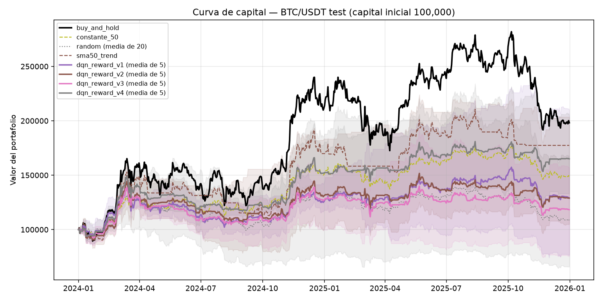
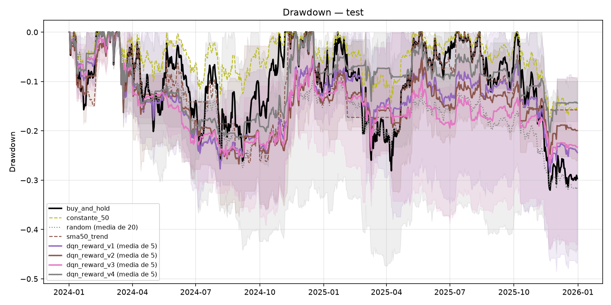
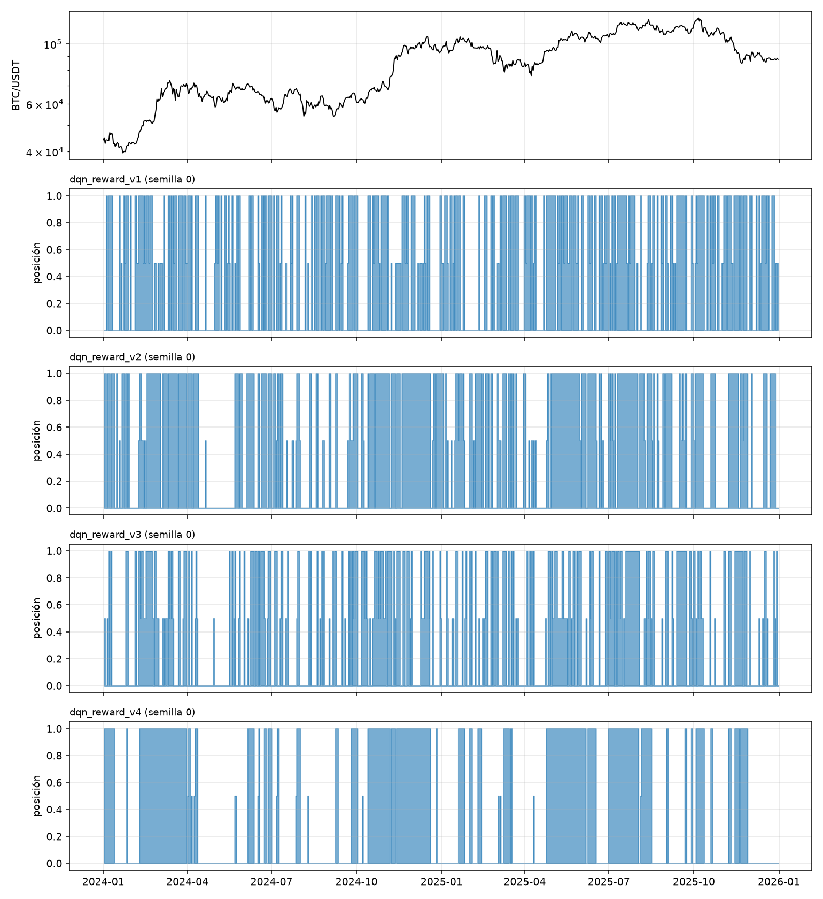

# Sabana Trading RL

## Agente inversor DQN con Reinforcement Learning para cripto (BTC/USDT)

Este agente DQN aprende cuánto capital exponer a **BTC/USDT** (0 %, 50 % o 100 %) a partir de velas históricas diarias, y se compara contra estrategias simples:

- Comprar y mantener (*buy & hold*)
- Azar
- Exposición constante del 50 %
- Tendencia SMA50

La comparación se hace en un período **held-out** que el agente nunca vio durante el entrenamiento ni la selección de hiperparámetros, para evitar *data leakage*.

La pregunta central: **¿puede un agente de RL aprender una estrategia que se comporte mejor que estrategias simples en datos que no vio?** La respuesta, con evidencia, está en [Resultados](#resultados).

## Secuencia de decisiones del agente

```
Observar el mercado -> Tomar una acción -> El precio cambia -> Recompensa (neta de costos) -> Volver a decidir
```

Los datos se descargan con el downloader de [Gym Trading Env](https://gym-trading-env.readthedocs.io/en/latest/download.html) (ccxt, solo cripto). El **entorno de simulación, el agente DQN y la evaluación son propios** (`src/`).

## Estructura

```
.
├── configs/            base.yaml + reward_v1/v2/v3/v4.yaml (versiones de la recompensa)
├── data/               BTCUSDT_1d.csv (procesado, se versiona) y data/raw/ (pickle crudo, no se versiona)
├── notebooks/eda.ipynb Análisis exploratorio (EDA)
├── results/            Salidas de evaluate: métricas y gráficos por split
├── src/
│   ├── data.py         Descarga, conversión, features causales, partición temporal, normalización solo con train
│   ├── environment.py  Entorno Gymnasium lookahead-safe (InvestmentEnv)
│   ├── agent.py        DQN desde cero (red Q, replay buffer, red objetivo, epsilon-greedy)
│   ├── train.py        Entrenamiento + validación + early stopping + checkpoints
│   ├── evaluate.py     Evaluación agente vs baselines, métricas, gráficos
│   ├── baselines.py    Azar, buy & hold, 50 % constante, tendencia SMA50
│   ├── metrics.py      Retorno, drawdown, Sharpe, costos, etc.
│   └── utils.py        Semillas y carga de configuración
├── tests/              Anti-lookahead, entorno, datos (formato del downloader) y agente
├── pyproject.toml
└── README.md
```

## Instalación

```bash
python -m venv .venv && source .venv/bin/activate     # Git Bash en Windows: source .venv/Scripts/activate
python -m pip install torch --index-url https://download.pytorch.org/whl/cpu    # opcional: torch liviano (CPU)
python -m pip install -e ".[dev]"
pytest -q
```

Python >= 3.10 (probado con 3.12). El código corre en CPU. En Windows, mantén el proyecto en una ruta corta (p. ej. `C:\dev\sabana_trading_rl`) y fuera de OneDrive.

## Datos

Dataset: **BTC/USDT**, velas diarias (`1d`) de **Binance**, 2017-08-01 -> 2025-12-31, descargadas con `gym_trading_env.downloader`.

```bash
python -m pip install -e ".[data]"     # instala gym-trading-env (fija ccxt==3.0.59, flask==2.2.5) y pandas<3
python -m src.data                     # lee data.download de configs/base.yaml
```

Esto genera `data/raw/binance-BTCUSDT-1d.pkl` (crudo) y `data/BTCUSDT_1d.csv` con el formato del proyecto:

```
timestamp,open,high,low,close,volume
```

`timestamp` es la hora de **apertura** de la vela en UTC. El comando imprime el **hash SHA-256 del CSV**, el número de velas y si hay huecos. Versiona el CSV para que cualquiera reproduzca exactamente el mismo experimento.

Detalles del downloader que el código ya maneja:

- **Zona horaria.** El downloader interpreta `since`/`until` en la zona horaria del computador; aquí se pasan en UTC explícito, así el resultado no depende de la máquina.
- **Primera vela.** Descarta la vela cuyo timestamp es igual a `since`; se compensa restando 1 ms.
- **Vela incompleta.** Se descarta la última vela si `date_close` es futuro (aún no ha cerrado).
- **pandas 3.** El downloader (v0.3.5) falla con pandas >= 3 (`TypeError ... 'datetime.timedelta'`). El extra `[data]` fija `pandas<3`.
- **Exchange bloqueado.** Si Binance no responde en tu país, cambia `data.download.exchange` a `bitfinex2` o `huobi`.

### Partición temporal (`configs/base.yaml`)

| Período | Fechas | Régimen | Uso |
|---|---|---|---|
| train | 2018 – 2021 | bajista 2018, lateral 2019, caída y auge 2020-21 | el agente aprende |
| val | 2022 – 2023 | caída de 2022 y recuperación | hiperparámetros, versión de la recompensa, early stopping |
| **test (held-out)** | 2024 – 2025 | auge posterior a 2023 | evaluación final, **una sola vez** |

`evaluate --split test` exige `--final` para evitar usar el held-out por accidente. Los datos de 2017 solo sirven de calentamiento para los indicadores.

## Ejecutar

```bash
# 1) Entrenar cada versión de la recompensa (5 semillas por defecto, ver train.seeds)
python -m src.train --config configs/reward_v1.yaml
python -m src.train --config configs/reward_v2.yaml
python -m src.train --config configs/reward_v3.yaml
python -m src.train --config configs/reward_v4.yaml
#    prueba rápida:  python -m src.train --config configs/reward_v1.yaml --seeds 0 --total-steps 5000

# 2) Evaluar en validación (aquí se decide qué recompensa e hiperparámetros usar)
python -m src.evaluate --runs-dir runs --split val

# 3) Solo baselines
python -m src.baselines --split val

# 4) Evaluación final sobre el held-out (una vez)
python -m src.evaluate --runs-dir runs --split test --final
```

Salidas en `runs/<config>/seed_<n>/` (`model.pt`, `train_log.csv`, `config.yaml`, `summary.json`) y en `results/<split>/`: `metrics_summary.csv`, `metrics_per_run.csv`, `equity_curves.png`, `drawdowns.png`, `positions.png` y `logs/*.csv` (posición, acción y costo por vela, útiles para buscar comportamientos anómalos).

## Diseño

### Cronología de una decisión (lookahead-safe)

En el **cierre** de la vela *t* (su `close` ya es conocido):

1. El agente observa `[features_t, posición_actual]` (solo datos hasta *t*).
2. Elige la posición objetivo `w_t ∈ {0, 0.5, 1}`; se ejecuta al precio de cierre de *t* y paga `|w_t − w_{t−1}| · V_t · cost_bps/10⁴`.
3. El precio pasa de `close_t` a `close_{t+1}`: `V_{t+1} = (V_t − costo) · (1 + w_t · r_{t+1} + (1 − w_t) · rf)`.
4. Recompensa y nueva observación `obs_{t+1}`.

`close_{t+1}` solo se usa para calcular el resultado de la acción, nunca para decidirla.

El episodio siempre empieza en efectivo (0 %), así que buy & hold también paga el costo de entrada.

**`terminated` vs `truncated`.** El fin de los datos o de la ventana de 365 velas se marca como `truncated`: el episodio se corta por una razón externa, no porque el estado sea terminal. En ese caso el objetivo del DQN conserva el término `γ · max Q(s', a')`, es decir, **hace *bootstrapping*** (usa la estimación de valor del estado siguiente como parte del objetivo de aprendizaje, no un remuestreo estadístico). `terminated` cortaría ese término y solo ocurriría con capital 0.

### Estado

`[ret_1, ret_7, ret_30, dist_sma20, dist_sma50, vol_20, rsi_14, vol_ratio, posición_actual]` (9 dimensiones).

Cada feature está definida y justificada en la docstring de `compute_features` (`src/data.py`). Como cripto opera 24/7, 7 y 30 velas son una semana y un mes calendario.

Control de lookahead:

- Todas las features son ventanas hacia atrás (rolling/ewm). Las primeras 50 velas se descartan (calentamiento).
- Los indicadores se calculan sobre la serie completa, de modo que val/test usen el historial previo real disponible en ese momento.
- La normalización (z-score, recorte a ±5) usa **solo** media y desviación del período train.
- `tests/test_lookahead.py` verifica que truncar la serie no cambia las features pasadas, que alterar el futuro no cambia el pasado, y que alterar val/test no cambia el train normalizado.

### Acciones

`{0 %, 50 %, 100 %}` -> `Discrete(3)`. Solo largo, sin apalancamiento ni posición corta. El efectivo rinde `rf_annual` (0 por defecto). Con tres niveles hay pocos parámetros que aprender y el costo por cambio es fácil de interpretar. El agente no puede vender en corto, apalancarse ni ajustar la posición con más finura.

### Costos

10 bps (0,10 %) sobre el capital negociado en cada cambio de posición, equivalente a la comisión spot típica de Binance. No incluye deslizamiento (*slippage*) ni impacto de mercado.

### Recompensa (iteración)

```
R_{t+1} = scale · [ log(V_{t+1}/V_t) − risk_aversion · log_ret² − dd_coef · max(0, Δdrawdown) − turnover_penalty · |Δw| ]
```

| Versión | Config | Idea |
|---|---|---|
| V1 | `reward_v1.yaml` | solo retorno logarítmico neto de costos (ingenua) |
| V2 | `reward_v2.yaml` | V1 + penalización al aumento del drawdown (`dd_coef = 1.0`) |
| V3 | `reward_v3.yaml` | V2 + penalización por rotación (`turnover_penalty = 0.002`) |
| V4 | `reward_v4.yaml` | V3 con penalización por rotación más fuerte (`turnover_penalty = 0.005`) |

Cada versión cambia **un solo parámetro** respecto a la anterior, de modo que cualquier diferencia se atribuye a ese cambio. Flujo de diseño: entrenar -> evaluar en validación (positions.png y diagnóstico de `evaluate`) -> ajustar -> reentrenar -> comparar. V4 nació de ese proceso: en validación, `turnover_penalty = 0.002` apenas reducía las operaciones (233 frente a 245 de V2) y los costos incluso subían. Con `scale = 100`, 0.002 equivale a ~0.2 unidades de recompensa por un cambio completo, frente a una desviación diaria de ~3 unidades: la red no lo percibía.

### DQN y hiperparámetros (`configs/base.yaml`)

| Parámetro | Valor |
|---|---|
| Red | MLP 9 -> 64 -> 64 -> 3, ReLU |
| Optimizador / pérdida | Adam, lr 5e-4 / Huber |
| γ | 0.99 |
| Batch / buffer | 64 / 50 000 |
| Pasos | 100 000 (episodios de 365 velas con inicio aleatorio) |
| Exploración | ε-greedy 1.0 -> 0.05, lineal en el 50 % de los pasos |
| Red objetivo | copia dura cada 500 actualizaciones |
| Double DQN | desactivado (`agent.double_dqn`) |
| Selección de modelo | mejor `val_sharpe`, evaluado cada 5 000 pasos |
| Criterio de parada | paciencia de 8 evaluaciones sin mejora, no antes de 30 000 pasos |
| Semillas | 0–4 (`train.seeds`) |

## Resultados

### Protocolo

1. Las versiones V1 -> V4 se iteraron **solo con validación** (2022-2023).
2. La regla de selección se fijó **antes** de ver el held-out: *mayor Sharpe medio en validación; si la diferencia es menor a un error estándar, menor drawdown y menores costos*. Con ella se eligió **V4**.
3. El held-out (2024-2025) se evaluó **una sola vez** con `--final`. V4 es el agente designado; las demás versiones se muestran solo para comparar.

Todas las cifras de los DQN son media ± desviación entre 5 semillas. Los baselines deterministas no tienen dispersión; el azar se promedia sobre 20 semillas. Datos: `results/val/` y `results/test/`.

### Validación (2022 – 2023)

| Estrategia | Retorno acum. | Sharpe | Máx. drawdown | Operaciones | Costos (% del capital) | Días en efectivo | Posición media |
|---|---|---|---|---|---|---|---|
| Comprar y mantener | -11.5 % | 0.16 | -67.0 % | 1 | 0.1 % | 0 % | 100 % |
| 50 % constante | +1.5 % | 0.16 | -40.1 % | 1 | 0.05 % | 0 % | 50 % |
| Tendencia SMA50 | +19.9 % | 0.44 | -50.6 % | 35 | 2.6 % | 55 % | 45 % |
| Azar (media de 20) | -26.2 % ± 30 | -0.34 ± 0.54 | -54.9 % ± 10 | 486 | 21.8 % | 33 % | 50 % |
| DQN V1 | -0.9 % ± 15 | 0.15 ± 0.22 | -56.0 % ± 6 | 317 | 15.8 % | 40 % | 48 % |
| DQN V2 | +1.0 % ± 9 | 0.19 ± 0.12 | -52.0 % ± 4 | 245 | 13.0 % | 51 % | 43 % |
| DQN V3 | +12.4 % ± 16 | 0.33 ± 0.20 | -47.2 % ± 3 | 233 | 14.3 % | 53 % | 41 % |
| **DQN V4** | +28.2 % ± 33 | 0.52 ± 0.38 | -44.3 % ± 13 | 164 | 9.0 % | 55 % | 38 % |

### Held-out (2024 – 2025)

| Estrategia | Retorno acum. | Sharpe | Máx. drawdown | Operaciones | Costos (% del capital) | Días en efectivo | Posición media |
|---|---|---|---|---|---|---|---|
| Comprar y mantener | +98.2 % | 0.95 | -32.0 % | 1 | 0.1 % | 0 % | 100 % |
| 50 % constante | +48.9 % | 0.95 | -17.3 % | 1 | 0.05 % | 0 % | 50 % |
| Tendencia SMA50 | +77.4 % | 0.99 | -26.5 % | 48 | 7.0 % | 43 % | 57 % |
| Azar (media de 20) | +8.6 % ± 27 | 0.23 ± 0.42 | -35.1 % ± 7 | 487 | 39.3 % | 33 % | 50 % |
| DQN V1 | +29.0 % ± 50 | 0.49 ± 0.58 | -31.7 % ± 10 | 309 | 27.6 % | 40 % | 48 % |
| DQN V2 | +28.9 % ± 42 | 0.52 ± 0.46 | -30.7 % ± 7 | 242 | 22.5 % | 51 % | 43 % |
| DQN V3 | +18.3 % ± 31 | 0.38 ± 0.51 | -30.1 % ± 9 | 240 | 20.1 % | 55 % | 38 % |
| **DQN V4** | +65.0 % ± 28 | 0.98 ± 0.24 | -24.3 % ± 3 | 143 | 13.7 % | 56 % | 39 % |





### Qué diferencia a cada estrategia

| Estrategia | Qué hace | Perfil en test |
|---|---|---|
| Comprar y mantener | 100 % invertido siempre | Máximo retorno (+98 %) y máximo riesgo: volatilidad 48 %, drawdown −32 % |
| 50 % constante | 50 % invertido siempre | Mismo Sharpe que buy & hold con la mitad del riesgo; **el menor drawdown de todos** (−17 %) |
| Tendencia SMA50 | 100 % si el precio está sobre su media de 50 velas; si no, 0 % | Mejor Sharpe (0.99, ≈ buy & hold), 48 operaciones, costos 7 % |
| Azar | acción aleatoria cada vela | +9 % pagando el 39 % del capital en comisiones: los costos consumen casi todo |
| DQN V1 | solo retorno neto | Opera casi a diario (309 operaciones, costos 28 %); resultados muy dispersos entre semillas |
| DQN V2 | + penalización al drawdown | Más tiempo en efectivo (51 %); Sharpe similar a V1 |
| DQN V3 | + penalización de rotación débil (0.002) | Casi no reduce operaciones (240); el peor DQN en test |
| **DQN V4** | + penalización de rotación fuerte (0.005) | Bloques largos de inversión, 143 operaciones, el mejor DQN: Sharpe 0.98, drawdown −24 % |

### Lectura de los resultados

**Respuesta a la pregunta central: parcialmente.** El agente final (V4) **iguala, pero no supera**, a las estrategias simples en retorno ajustado por riesgo: su Sharpe (0.98) es indistinguible del de comprar y mantener (0.95) y del de SMA50 (0.99). Frente a buy & hold tiene menor drawdown (−24 % frente a −32 %) pero menor retorno (+65 % frente a +98 %); frente al 50 % constante tiene el mismo Sharpe y peor drawdown. V1–V3 quedan por debajo de las tres estrategias simples.

1. **V4 es la única versión que se sostiene fuera de la muestra de validación.** Su Sharpe (0.98) supera al de V3, V2 y V1 (diferencias de 0.46 a 0.61; z aproximado entre 1.8 y 2.4 con 5 semillas), tiene menor dispersión entre semillas (desviación del Sharpe 0.24 frente a 0.46–0.58) y sus 5 semillas tienen menor drawdown que buy & hold.
2. **La palanca efectiva fue la penalización por rotación, no la de drawdown.** V1 -> V2 (drawdown) y V2 -> V3 (rotación débil) no cambian el Sharpe de forma distinguible. V3 -> V4 (rotación fuerte) sí lo hace, con 30 % menos operaciones y 37 % menos costos en validación.
3. **Menos operaciones, mejores resultados (con matices).** En validación el orden por Sharpe es exactamente el inverso al de operaciones (V4 > V3 > V2 > V1 frente a 164 < 233 < 245 < 317 operaciones). En test se mantiene para V4 (menos operaciones y mejor Sharpe), pero no para V3, que opera menos que V1 y V2 y rinde peor: operar menos ayuda, pero no es la única causa.
4. **El orden de V1–V3 en validación no se sostuvo.** En validación V3 > V2 > V1 (Sharpe 0.33, 0.19, 0.15); en test V2 > V1 > V3 (0.52, 0.49, 0.38). Las diferencias entre ellas están dentro del ruido (5 semillas): no se puede afirmar que una sea mejor que otra.
5. **Ninguna versión supera a buy & hold en retorno** en un mercado que duplicó su valor. Los agentes pasan entre el 40 % y el 56 % del tiempo en efectivo.

### Comportamiento inesperado

- **Pérdidas en un mercado alcista.** V1 semilla 1 perdió −23 % mientras BTC casi duplicaba su valor (drawdown −48 %, peor que buy & hold), con 319 operaciones y 26 mil dólares en comisiones. V3 semilla 0: −24 % y drawdown −44 %. Son agentes que aprendieron una política que opera ruido y paga costos.
- **La semilla importa tanto como la recompensa.** En V1 el retorno va de −23 % a +110 % según la semilla; las semillas 3 de V1 y V2 superan a buy & hold en retorno (+110 % y +103 %).
- **Sesgo conservador.** Con la penalización al drawdown, los agentes dejan más del 40 % del tiempo fuera del mercado incluso en un auge. Es una posible forma de *reward hacking* leve: el efectivo no puede generar drawdown. Entrenaron con 2018–2021, que incluye caídas muy fuertes (2018, marzo de 2020 y 2021).
- **La posición del 50 % se usa poco** (~10–24 % del tiempo): los agentes saltan sobre todo entre 0 % y 100 %.

### Ventaja sobre buy & hold y régimen de mercado

El Sharpe de **todas** las estrategias sube entre validación y test, incluidas las que no se entrenan (buy & hold pasa de 0.16 a 0.95), porque 2024-2025 fue un mercado mucho más alcista que 2022-2023. Una diferencia absoluta entre períodos mide principalmente el régimen, no el sobreajuste. La comparación informativa es la **ventaja sobre buy & hold** en cada período:

| Versión | Sharpe val | Sharpe test | Ventaja sobre buy & hold en val | Ventaja sobre buy & hold en test |
|---|---|---|---|---|
| DQN V1 | 0.15 | 0.49 | -0.01 | -0.47 |
| DQN V2 | 0.19 | 0.52 | +0.03 | -0.43 |
| DQN V3 | 0.33 | 0.38 | +0.17 | -0.58 |
| **DQN V4** | 0.52 | 0.98 | +0.36 | +0.03 |
| Tendencia SMA50 | 0.44 | 0.99 | +0.28 | +0.04 |
| Comprar y mantener | 0.16 | 0.95 | – | – |

La ventaja de todas las versiones se **encoge** en test: la de V4 pasa de +0.36 a +0.03 y la de V3 de +0.17 a −0.58. Hay dos causas mezcladas. Una es el régimen: SMA50, que no se entrena, también pasa de +0.28 a +0.04, porque en un auge sostenido cualquier estrategia con menos exposición queda en desventaja frente a buy & hold. La otra es la selección: elegir el mejor checkpoint de cada semilla y la mejor de 4 versiones con la misma validación infla la cifra de validación, por eso la cifra honesta es la del held-out. Entre las versiones DQN, V4 es la única que mantiene una ventaja no negativa.

Semillas que superan el Sharpe de buy & hold en cada período:

| Versión | Semillas con Sharpe > buy & hold (val) | Semillas con Sharpe > buy & hold (test) |
|---|---|---|
| DQN V1 | 2 / 5 | 1 / 5 |
| DQN V2 | 3 / 5 | 1 / 5 |
| DQN V3 | 4 / 5 | 0 / 5 |
| **DQN V4** | 4 / 5 | 3 / 5 |

## Reproducibilidad

- Semillas fijadas para `random`, `numpy` y `torch`. El entorno y el replay buffer usan la misma semilla. El entrenamiento es en CPU.
- `config.yaml` se guarda junto a cada modelo en `runs/`. El hash SHA-256 del CSV identifica los datos exactos.
- El agente aleatorio se promedia sobre 20 semillas (`--n-random`).
- Con las mismas versiones de librerías y el mismo CSV, una semilla da el mismo resultado. Entre plataformas distintas puede haber pequeñas diferencias numéricas.

## Limitaciones conocidas

- Ejecución al precio de cierre de la misma vela, sin deslizamiento ni impacto de mercado.
- Un solo activo y un único par train/test: los resultados dependen del período. El held-out cubre 2 años de un mismo régimen alcista; con 5 semillas, las diferencias entre versiones cercanas están dentro del ruido estadístico.
- Train tiene ~1 460 velas, pocas para una red neuronal.
- La validación es optimista: se usó para elegir el mejor checkpoint de cada semilla y para elegir entre 4 versiones de la recompensa.
- BTC/USDT es muy volátil (drawdowns de buy & hold de −60 % o más). Un agente que iguala el Sharpe de buy & hold con menor drawdown es un resultado válido, pero no demuestra por sí mismo una ventaja del RL.
- El downloader fija versiones antiguas de `ccxt` y `flask`. Instálalo solo si necesitas descargar datos.
